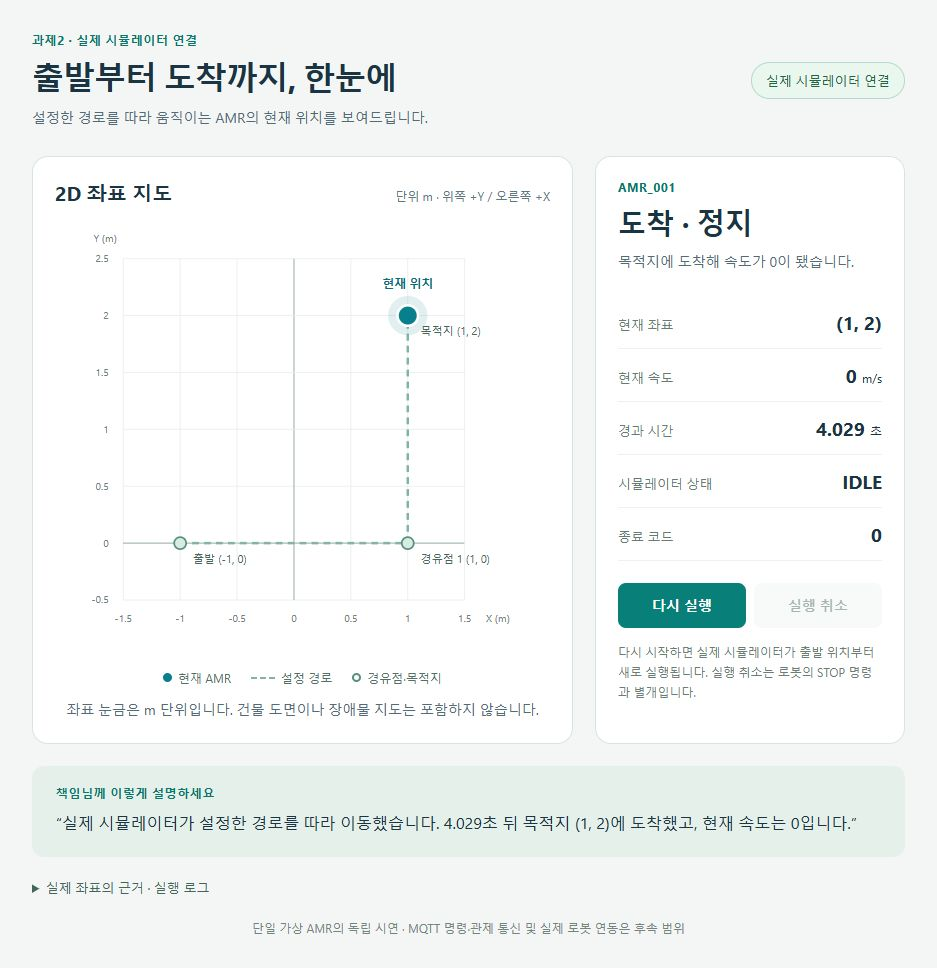

# AMR 개발 보고서

가상 AMR 관제 시스템 | 진행 현황과 협업 공유

보고 기준일: 2026-10-22 KST | 버전: v1.2 | 작성 보조: Codex

## 1 지금 어디까지 진행됐나

**단일 AMR의 이동·도착 실행본은 개발 통합 브랜치(develop)에 반영됐다. MQTT로 좌표를 보내고 지도에 표시하는 확장도 구현·검증 기록이 있으며, 정식 반영과 화면 확인이 남아 있다.**

목표는 가상 로봇의 위치·상태를 관제 화면에서 확인하고, 명령을 보내 결과와 이력을 관리하는 것이다. 현재는 이 목표를 향해 통신과 단일 AMR 이동을 연결하는 단계다.

### 과제별 현황과 요구 충족 범위

<!-- widths: 23,19,31,27 -->
| 과제·관련 요구/기능 | 작업 상태 | 이번에 확인된 범위 | 남은 요구 범위 |
| --- | --- | --- | --- |
| 과제1 통신 / R-04 / COM-01·03·04·05 일부 | 진행 중, 잔여 보류 | 접속·수신 검사·큐·연결 상실 감지·명령 발행 일부 반영 | 개별 AMR 감시·요청/ACK 대조·자동 복구 |
| 과제2 가상 AMR / R-02·03 / AMR-01·02·05 일부 | 진행 중 | 설정 기반 단일 AMR 이동·도착 반영 완료. MQTT 확장은 보존 구현·기존 검증 통과 | MQTT 정식 반영, 격자 탐색, 다중 AMR·알람·명령 동작 |
| 과제3 화면 / R-05 / GUI-02 일부 | 지도 일부 구현, 전체 GUI 미착수 | 직접 연결 지도와 MQTT 수신 지도 검증 기록 | 지도 반영·MQTT 화면 대조, 정식 GUI·Mock/DataProvider |
| 과제4 업무 처리·DB / R-06·07 / CORE-01~05 | 미착수·미검증 | DataProvider·명령·ACK 설계 원칙 확정 | 장비·상태·알람·명령 처리, SQLite 저장·조회 |
| 과제5 통합 / R-01·07 / INT-01~04 | 미착수·미검증 | 연결 시나리오·확인 조건 계획 | 실제 모듈 연결과 전체 시나리오 시험 |

요구사항 일부의 구현·검증과 과제 전체 완료를 구분한다. 상세 범위는 [R-01~07](../명세/요구사항정의.md)과 [기능별 완료조건](../명세/기능명세.md)을 따른다.

### 이번에 공유할 핵심

- **완료:** 단일 AMR 첫 실행본의 개발·검증·반영. [PR #35](https://github.com/inhhlee/amr-control-system-demo/pull/35)·[PR #36](https://github.com/inhhlee/amr-control-system-demo/pull/36)·[PR #37](https://github.com/inhhlee/amr-control-system-demo/pull/37), [Issue #28 완료](https://github.com/inhhlee/amr-control-system-demo/issues/28).
- **다음 결과물 제안:** 기존 MQTT 송수신 구현을 별도 PR로 정리하고, 이후 수신 지도 PR로 연결한다. PR은 변경 내용을 검토하고 합치기 위한 단위다.
- **확인 필요:** 다음 작업의 착수·완료 기한과 검토 시점. 과제 전체 기한과 실제 리뷰 담당자는 미정이다.

신입 개발자 1명이 진행하는 기존 기준을 따른다. 과제는 기능별 책임 구분이며 인원 배정을 뜻하지 않는다. 구현·시험·리뷰·반영을 한 작업씩 마치고 결과를 공유한다.

상세: [전체일정](../전체일정.md#task2-current-status) · [10/22 확인 기록](../../일일업무/2026-10-22.md#mqtt-map-status)

보고의 개발·검증 수치는 10/20~21 실행 기록과 10/22 확인된 반영 상태를 기준으로 한다. 이번 수정은 보고 구성 정리이며 제품 재시험이나 새로운 완료 판정을 추가하지 않았다.

<!-- pagebreak -->

## 2 내 프로젝트 구조와 협업 경계

### 목표 역할과 연결 책임

현재 개발 통합 브랜치의 프로젝트는 `Amr.Communication`, `Amr.Communication.Console`, `Amr.Simulator`다. 정식 GUI·Core·SQLite 연결은 후속 구현이다. Contracts 추출과 MQTT 연결 계층의 별도 프로젝트 구성은 후보다. 아래는 후속 구현을 포함한 목표 책임이며, 현재 구현·검증 여부는 1절 상태표를 따른다.

<!-- widths: 22,36,42 -->
| 담당 범위 | 맡는 일 | 다음 작업에 전달할 내용 |
| --- | --- | --- |
| 과제2 Simulator | 설정에 따라 이동하고 위치·상태·응답 생성 | AMR 식별자, 좌표·속도·상태, 재현 설정과 송신 예시 |
| 과제1 Communication | MQTT 접속·송수신·형식 검사 | 검증된 수신 데이터, 연결 상태, 송수신 결과 |
| MQTT 연결 계층 / 구성 후보 | 수신 DTO를 Core 입력으로 변환하고 Core 명령을 발행 | 변환 규칙·통신 실패 전달 방식. Core가 MQTT 클라이언트를 직접 다루지 않도록 연결 |
| 과제4 Core·저장 계층 | 최신 상태·알람·명령 판단, 업무 이력 저장·조회 | 장비 상태와 변경 알림, 명령 처리 결과, 저장·조회 결과 |
| 과제3 GUI | 목록·지도·알람·이력 표시와 사용자 명령 입력 | Mock 실행 화면, 실제 공급자로 교체한 결과와 화면 확인 근거 |

> 보존 구현의 검증 경로: Simulator → MQTT Broker → Communication → 수신 지도 시연 도구

> 목표 연결: Communication → 연결 계층 → Core → DataProvider → GUI. Core의 이력은 저장 계층을 통해 SQLite로 연결한다.

첫 경로의 MQTT·지도 확장은 보존 브랜치에 있고 정식 반영이 남아 있다. 두 번째 경로는 후속 구현의 연결 방향이다. 과제5에서 실제 모듈을 연결해 같은 AMR의 실행·화면·이력이 맞는지 확인한다.

### 함께 지킬 결정과 선택 이유

- **화면 데이터:** DataProvider의 조회+비동기 스트림은 초기 상태와 이후 변경을 함께 제공하기 위한 선택이다. Mock과 실제 구현을 같은 계약으로 교체하며 UI 스레드 전환은 GUI가 맡는다. 초기 스냅샷·변경 사이의 누락 방지는 별도 구현·시험이 필요하다.
- **명령과 응답:** 기존 SUCCESS/FAILURE 규격으로 동작 완료 결과를 추적하기 위해 최종 ACK를 선택했다. GUI는 ICommandDispatcher로 요청하고 Core가 CommandId를 생성·기록한다. 접수와 완료를 구분하며, 긴 명령의 접수·진행 여부는 이 ACK만으로 알 수 없다.
- **단절과 대기:** 통신 끊김만으로 로봇 고장·정지를 단정하지 않도록 연결 상태와 동작 상태를 분리한다. 대기 기한 초과는 실행 결과 미확인으로 다루고 자동 재전송하지 않는다. 버퍼 상한·Timeout 수치는 미정이다.

명령 기능을 연계할 때는 대상 AMR과 CommandId를 유지하고, 늦은 응답·중복 응답·STOP에 의한 MOVE 중단을 아래 계약으로 대조한다. 현재 메시지의 IDLE/BUSY/STOPPED/FAULT와 SUCCESS/FAILURE 값은 유지한다.

상세: [프로젝트 참조 방향](../명세/공통규칙.md#module-dependencies) · [DataProvider·명령 계약](../명세/공통데이터명세.md#provider-command-contract) · [ACK 기준](../명세/공통데이터명세.md#ack-processing-contract)

<!-- pagebreak -->

## 3 무엇을 만들고 어떻게 확인했나

### 단일 AMR 이동·도착 결과

설정의 경유점 (-1, 0) → (1, 0) → (1, 2)를 속도 1m/s로 이동한다. 도착하면 상태가 BUSY에서 IDLE로 바뀌고 현재 속도는 0이 된다. 잘못된 설정과 이동 중 취소는 정상 도착과 구분한다.

그림 1. 10/21 직접 Simulator 출력 연결 모드의 도착 화면. 좌표 (1, 2), 속도 0, IDLE, 종료 코드 0을 확인했다. 4.029초는 해당 실행의 관찰값이다. MQTT 수신 화면과 정식 관제 GUI의 검증은 별도로 남아 있다. [화면·실행 근거](https://github.com/inhhlee/amr-control-system-demo/blob/a8934f0bfed803cee47d7c2e13775ba648e0862a/evidence/AMR/20261021-map-01/README.md)

### 대표 검증 사례 - 조건과 결과 대조

아래는 10/21 기존 실행 근거다. 전체 시험 건수·코드 버전·실행 안내는 5절에 연결했다.

<!-- widths: 21,30,33,16 -->
| 항목·조건 | 예상 결과 | 실제 결과 | 판정·근거 |
| --- | --- | --- | --- |
| AMR-01·02 일부 / 기본 경로 | (1,2) 도착, IDLE·속도 0·종료 0 | 완료 로그와 최종 값 일치, 종료 0 | 통과 / [콘솔 결과](https://github.com/inhhlee/amr-control-system-demo/blob/9cc908d55a1fca0efab865556baae95bad944147/evidence/AMR/20261021-pr34-split-console-01/verification.json) |
| AMR-01 / 잘못된 속도 설정 | 이동 전 설정 거부, 오류 필드·종료 1 | speedMps 거부, 종료 1 | 통과 / [거부 결과](https://github.com/inhhlee/amr-control-system-demo/blob/9cc908d55a1fca0efab865556baae95bad944147/evidence/AMR/20261021-pr34-split-console-01/verification.json) |
| GUI-02 일부 / MQTT 도착 | 수신 좌표·지도 데이터·최종 화면 일치 | 수신 21건과 지도 데이터 일치. 같은 실행의 최종 화면 대조는 남음 | API 통과 / 화면 미검증 / [결과](https://github.com/inhhlee/amr-control-system-demo/blob/a8934f0bfed803cee47d7c2e13775ba648e0862a/evidence/AMR/20261021-mqtt-map-check-01/verification.json) |
| MQTT 지도 / Broker 단절 | 도착으로 오인하지 않고 비정상 종료 | 단절 시 거짓 도착 없음, 종료 1 | 통과 / [단절 결과](https://github.com/inhhlee/amr-control-system-demo/blob/a8934f0bfed803cee47d7c2e13775ba648e0862a/evidence/AMR/20261021-mqtt-map-check-01/verification.json) |

명령 최종 ACK·정식 GUI 공급자 교체·Core/DB 전체 연계는 미검증이다. 직접 지도 HTTP 표본 141개와 MQTT 지도 표본 135개는 시험 건수가 아니다.

<!-- pagebreak -->

## 4 남은 작업과 협의할 내용

### 다음 작업 순서 제안

현재 확인된 문제는 MQTT·지도 코드의 정식 반영이 남았고, 일부 실행 안내와 MQTT 최종 화면 근거를 보완해야 한다는 점이다. 기존 과제계획의 제안 순서를 아래처럼 공유한다. 일정과 새 Issue·PR 번호는 아직 정해지지 않았다.

<!-- widths: 8,25,34,33 -->
| 순서 | 작업·연결 과제 | 다음 행동 | 다음 검토에 가져올 결과물 |
| --- | --- | --- | --- |
| 1 | MQTT 송수신 반영 / 과제1·2 | 보존 구현에서 필요한 변경을 분리하고 대상 코드·기존 근거 대조 | MQTT 전용 PR, 송수신 일치 근거, 차이가 있는 경로의 회귀 결과 |
| 2 | 수신 지도 반영 / 과제2·3 | MQTT PR 뒤 지도 PR 구성. 직접 연결/MQTT 안내와 화면 대조 보완 | 동일 실행의 수신 좌표·화면, 도착·취소·재실행·단절 확인 |
| 3 | 격자 경로 비교 / 과제2·3 | 승인한 입력·탐색·이동·비교 표시 구현 | 같은 지도에서 두 경로·최단거리·탐색 확정 셀 수·계산 시간, 실제 도착 결과 |
| 후속 | 명령·알람·정식 GUI·Core·DB / 과제1~5 | 과제1 재개 범위 조율 후 기능 단위로 구현·시험·연결 | 요청/최종 ACK 결과, Mock/실제 GUI, DB 이력, 전체 통합 시나리오 근거 |

### 알고리즘 적용 요약 - 승인된 후속 범위

**목적:** 단일 AMR이 고정 장애물을 피하는 최단 경로를 구하고, 선택한 경로를 따라 이동하도록 한다. 다익스트라와 A*를 같은 정적 격자·4방향 이동 조건에서 비교한다.

과제2는 최단거리·탐색 확정 셀 수·계산 시간을 기록하고 선택 경로를 이동한다. 과제3은 탐색 결과·실제 위치를 표시한다. 경로 없음·출발=도착·잘못된 입력·전환도 확인하며, A*가 항상 우수해야 통과하는 기준은 아니다. 현재는 계획 승인까지로 개발 미착수·실행 미검증이다.

상세: [격자 탐색 작업·완료조건](../과제2/과제계획.md#grid-pathfinding-work) · [화면 비교 작업](../과제3/과제계획.md#grid-pathfinding-view-work)

### 결정이 필요한 내용

<!-- widths: 29,36,35 -->
| 미정 항목 | 협의할 시점 | 정하지 않으면 남는 문제 |
| --- | --- | --- |
| 버퍼 상한, 발행·결과 대기·종료 Timeout 수치 | 공급자·명령 처리 구현 및 관련 시험 전 | 초과·대기 종료의 시험 조건을 확정할 수 없음 |
| 명령 허용표·RESET 복구 조건 | AMR 명령 동작과 Core 연결 전 | 명령 실행·거부·성공의 판단이 모듈마다 달라질 수 있음 |
| 장비 등록·최신 상태 선택·저장 실패 정책 | 해당 Core·DB 기능 착수 전 | 입력 반영·재처리·이력의 기준이 맞지 않을 수 있음 |

현재 다음 협의는 MQTT 결과물 착수·검토 시점이다. 과제1 잔여 재개는 늦어도 Command/ACK 연결 전 조율한다. 정확한 오류 코드·취소 경합·보존 기간 등 남은 상세는 [결정사항](../명세/검토%20및%20결정사항.md#provider-ack-decisions)에서 관리한다.

상세: [MQTT·지도 결과물과 완료조건](../과제2/과제계획.md#mqtt-map-next-deliverable) · [과제1 보류·재조율 조건](../전체일정.md#task2-priority)

<!-- pagebreak -->

## 5 재현과 협업에 필요한 문서

### 확인 버전·실행 안내·전체 검증 결과

버전은 10/22 보고 기준이다. 첫 실행본의 반영 코드는 2ccdd25, 분리 시험 근거는 9cc908d다. MQTT·지도는 보존 코드 a8934f0을 사용한다. 실행 위치는 `C:/amr-control-system-demo`, SDK·설정은 해당 버전의 파일을 기준으로 확인한다.

<!-- widths: 23,42,35 -->
| 대상·확인 버전 | 재현할 때 볼 안내 | 기존 검증 결과·근거 |
| --- | --- | --- |
| 통신 연결 감시 / [PR #31](https://github.com/inhhlee/amr-control-system-demo/pull/31) | [실행 조건·절차·완료조건](../과제1/산출물/2026-10-20_COM03-C4_경합과최종취합_20261020-c4-unit-02_검증결과.md) | 10/20 제품 자동 768건 통과. 도구 30건·실제 MQTT 4실행은 별도 근거 |
| 첫 AMR 실행본 / [2ccdd25](https://github.com/inhhlee/amr-control-system-demo/tree/2ccdd2511fed8a146f8338250cbaa813198c0fca) | [실행 안내](https://github.com/inhhlee/amr-control-system-demo/blob/2ccdd2511fed8a146f8338250cbaa813198c0fca/tests/manual/AMR01/README.md) · [기본 설정](https://github.com/inhhlee/amr-control-system-demo/blob/2ccdd2511fed8a146f8338250cbaa813198c0fca/config/simulator.single.json). Windows 콘솔, Broker 없이 실행 | 10/21 자동 135건·실제 콘솔 6시나리오 통과 / [분리 검증](https://github.com/inhhlee/amr-control-system-demo/blob/9cc908d55a1fca0efab865556baae95bad944147/evidence/AMR/pr34-split-check/README.md) |
| MQTT 송수신 / [a8934f0](https://github.com/inhhlee/amr-control-system-demo/tree/a8934f0bfed803cee47d7c2e13775ba648e0862a) | [MQTT 실행 안내 2절](https://github.com/inhhlee/amr-control-system-demo/blob/a8934f0bfed803cee47d7c2e13775ba648e0862a/tests/manual/AMR01/MQTT-DEMO.md). Docker·시험 Broker 이미지 필요, 새 실행 ID 사용 | 10/21 자동 151건·실제 7시나리오 통과 / [검증 모음](../과제2/과제계획.md#task2-verification-status) |
| 수신 지도 / a8934f0 | 직접 모드: [지도 안내](https://github.com/inhhlee/amr-control-system-demo/blob/a8934f0bfed803cee47d7c2e13775ba648e0862a/tools/Amr.Simulator.Map/README.md). MQTT 모드: 지도 빌드 후 [시작](https://github.com/inhhlee/amr-control-system-demo/blob/a8934f0bfed803cee47d7c2e13775ba648e0862a/tests/manual/AMR01/Start-MqttMap.ps1) → [검증](https://github.com/inhhlee/amr-control-system-demo/blob/a8934f0bfed803cee47d7c2e13775ba648e0862a/tests/manual/AMR01/Verify-MqttMap.ps1) → [종료](https://github.com/inhhlee/amr-control-system-demo/blob/a8934f0bfed803cee47d7c2e13775ba648e0862a/tests/manual/AMR01/Stop-MqttMap.ps1) | 10/21 자동 9건·실제 5시나리오 통과 / [수신 판정](https://github.com/inhhlee/amr-control-system-demo/blob/a8934f0bfed803cee47d7c2e13775ba648e0862a/evidence/AMR/20261021-mqtt-map-check-01/verification.json)·최종 화면 대조는 남음 |

MQTT 지도 도구는 Windows·Docker·지정 Broker 이미지와 새 실행 ID가 필요하다. 시작 시 출력한 주소·세션을 사용하며 설치 경로는 실행 환경과 대조한다. 일부 README의 “MQTT 지도 후속” 표시는 옛 기록으로, 현재 범위는 1·3절을 따른다. 기존 개발환경 문서의 C:/practice 실행 절을 새 저장소 명령으로 대신 사용하지 않는다.

시험·시나리오·상태 표본은 합산하지 않는다. 초기 실행 실패와 이후 통과 근거는 원본에 보존했으며, 이번 보고 수정에서는 제품을 실행하지 않았다.

### 상세 내용과 다음 공유

<!-- widths: 25,75 -->
| 확인할 내용 | 기존 담당 문서 |
| --- | --- |
| 요구·기능·완료조건 | [요구사항정의](../명세/요구사항정의.md) · [기능명세](../명세/기능명세.md) |
| 설계·계약·승인과 미정 | [공통규칙](../명세/공통규칙.md) · [공통데이터명세](../명세/공통데이터명세.md) · [검토 및 결정사항](../명세/검토%20및%20결정사항.md#provider-ack-decisions) |
| 진도·작업·시험 계획 | [전체일정](../전체일정.md) · [10/22 기록](../../일일업무/2026-10-22.md) · [과제1](../과제1/과제계획.md) · [과제2](../과제2/과제계획.md) · [과제3](../과제3/과제계획.md) · [과제4](../과제4/과제계획.md) · [과제5](../과제5/과제계획.md) |
| 코드·환경·협업 절차 | [코드 저장소](https://github.com/inhhlee/amr-control-system-demo) · [개발환경](../개발환경.md) · [개발 진행 절차](../../기준/개발%20진행%20절차.md) |

다음 공유에는 **과제·기능/Issue, 실제 한 일, 시험 결과·근거, 반영 상태, 다음 행동·요청 사항**을 적는다. 담당자·기한은 정해진 값만 쓰고 상세 진도는 기존 계획·일일업무에서 관리한다.

### 구성 참고·문서 이력

[EnjoyTrip Java](<C:/싸피 자료/자바전공_ENJOYTRIP_16_01 (2).pdf>) 3~4·10·12쪽, [Front](<C:/싸피 자료/자바전공_enjoytrip_16_03_프론트.pdf>) 4~7·16쪽, [Algorithm](<C:/싸피 자료/자바전공_enjoytrip_16_04_알고리즘.pdf>) 3·5~6쪽의 역할·화면·결과 구성과 [AI코어프로젝트 자료](<C:/싸피 자료/AI코어프로젝트_2회차_요구사항정의서-o4ipaxbtbb8rjf3oosp75jk39y.pdf>) 7~10·18~22쪽의 요구·검증 연결을 참고했다. 교육용 기능·기술·기한·제출 지시는 AMR 요구로 적용하지 않았다.

v1.0 현황 정리 → v1.1 협업 중심 구성 → v1.2 요구 충족 범위·검증 사례·재현 링크·설계 이유·탐색 셀 수 보완. 기존 명세·계획·코드·실행 기록은 유지했다. 보고서는 작성 보조 초안이며 사용자 검토 대기다.
